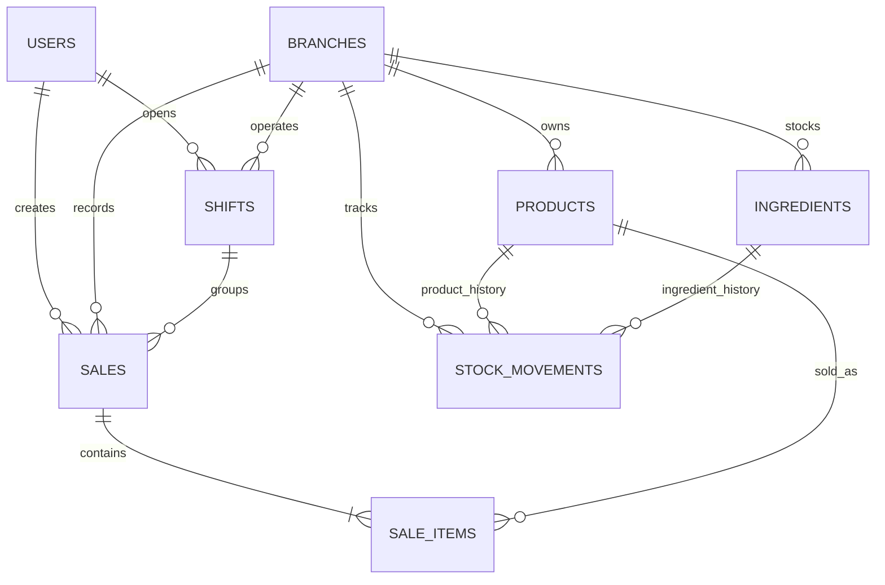

# Database schema and data dictionary

Database engine: PostgreSQL (Neon, Supabase, or local PostgreSQL). Executable baseline DDL: [database_schema.sql](./database_schema.sql), mirrored at `server/database/schema.sql`.

## Entity relationship diagram

## Tables and key columns

| Table | Important columns | Constraints / purpose |
|---|---|---|
| `users` | id, username, email, password_hash, role, created_at | Primary key; unique username/email; role user/admin; bcrypt hash only |
| `branches` | id, name, manager_name, status | Unique branch name; active/attention/inactive |
| `products` | id, branch_id, name, price, stock, unit, is_active | Branch FK; unique branch/name; nonnegative price and stock |
| `ingredients` | id, branch_id, name, stock, minimum_stock, unit | Branch FK; unique branch/name; nonnegative stock/minimum |
| `shifts` | id, branch_id, name, opened_by, closed_by, started_at, ended_at, status | Branch and user FKs; status/time consistency |
| `sales` | id, order_code, branch_id, shift_id, created_by, payment_method, total_amount | Unique order code; branch/shift/user FKs; nonnegative total |
| `sale_items` | id, sale_id, product_id, product_name, unit_price, quantity, subtotal | Sale/product FKs; quantity > 0; snapshot of sold product name/price |
| `stock_movements` | id, branch_id, item_type, product_id, ingredient_id, movement_type, quantity_before, quantity_after, note, created_by | Audit history for adjustment/sale/restock; exactly one product or ingredient FK |

## Seed data

The DDL idempotently creates the three branches and the sample menu and raw materials shown in the completed frontend. Initial product and ingredient inventory is seeded for Cabang Nganjuk only. It also creates a default active Shift Siang if that branch does not already have an active shift.

## Data integrity and security

- Stock and price cannot be negative; product sales quantity must be positive.
- Unique constraints prevent duplicate menu/material names within a branch.
- Foreign keys prevent deleting branches/products referenced by operational records.
- Stock adjustment and checkout write audit records in the same database transaction as stock changes.
- Checkout uses row locks to prevent concurrent sales from overselling inventory.
- API queries use parameterized values; credentials are provided through environment variables.
