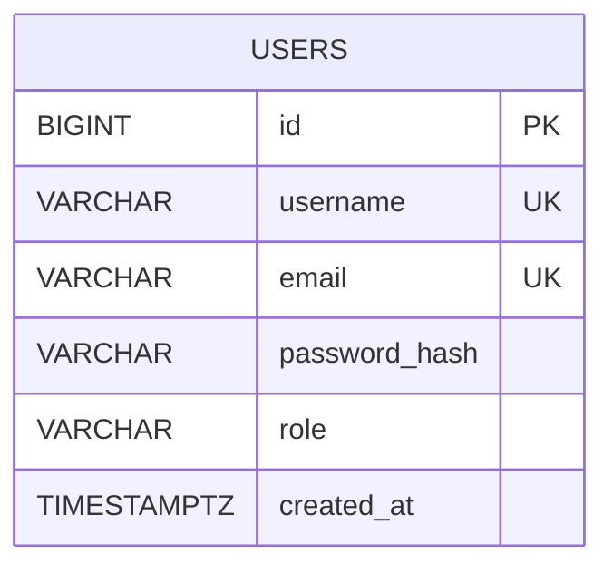

# Database schema and data dictionary

Database engine: PostgreSQL (cloud provider such as Neon or Supabase). The executable baseline DDL is in [database_schema.sql](./database_schema.sql).

## ERD

The current authentication baseline has one entity, `users`. There are no foreign keys yet because no dependent domain entities have been defined in the supplied project requirements.

## Data dictionary

| Column | Type | Constraints | Purpose |
|---|---|---|---|
| `id` | BIGINT identity | Primary key, not null | Unique user identifier |
| `username` | VARCHAR(30) | Unique, not null; 3–30 permitted characters | Login/display identifier |
| `email` | VARCHAR(254) | Unique, not null | User email address |
| `password_hash` | VARCHAR(255) | Not null | bcrypt hash only; never store plaintext passwords |
| `role` | VARCHAR(20) | Not null, default `user`, CHECK `user/admin` | Role claim for future RBAC |
| `created_at` | TIMESTAMPTZ | Not null, default current timestamp | Creation time |

Unique constraints protect username and email. `idx_users_email_lower` supports case-insensitive email lookup. API queries use parameterized PostgreSQL placeholders (`$1`, `$2`, …) to reduce SQL-injection risk.

## Apply the schema

Run the contents of `database_schema.sql` against the PostgreSQL database configured by `DATABASE_URL`. Do not commit real credentials.
